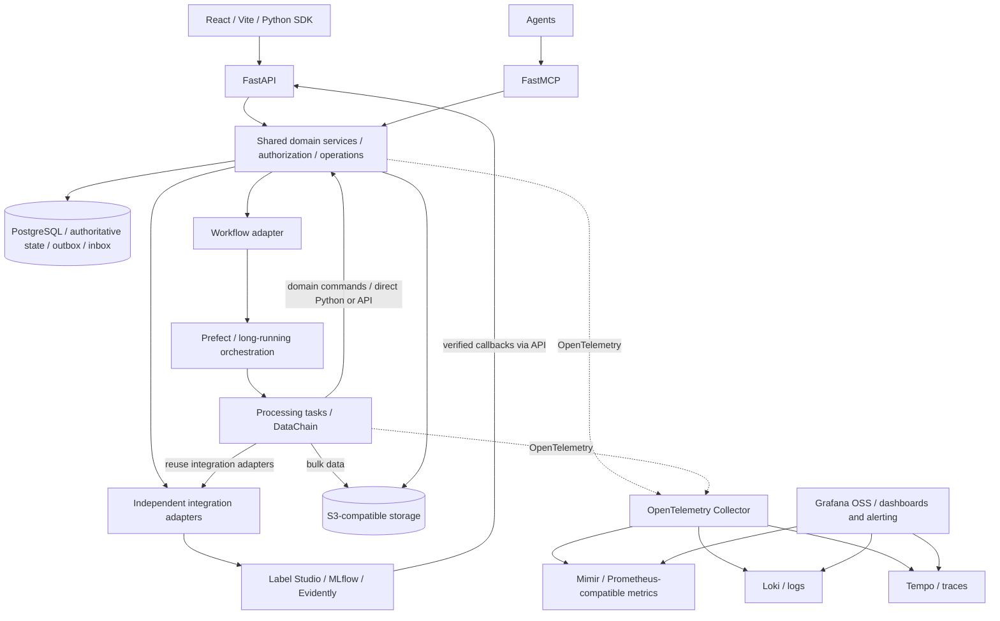

Verdant's accepted target is a dataset-first modular Python monolith with independently scalable workers. The source currently may still implement the former digestion runtime.

PostgreSQL owns registry, revisions, membership, lineage, operations, events/outbox/inbox and audit. Object storage owns sample bytes, manifests and report artifacts. Pydantic v2 validates contracts; SQL constraints and shared domain services protect integrity and authorization.

Published dataset versions pin exact sample/annotation revisions, splits, schema, transformations and manifest digest. Draft edits or new reports cannot mutate published bytes. Workers process bulk data directly in storage; APIs expose bounded metadata and operations.

OIDC/OAuth 2.0 identities authorize humans, services and agents. Prefect orchestrates; DataChain processes; Label Studio handles annotation; MLflow tracks experiments/models; Evidently evaluates quality/drift; OpenTelemetry exports signals through the OpenTelemetry Collector to Mimir (Prometheus-compatible metrics), Loki (logs) and Tempo (traces), queried through Grafana OSS.

In the repository, `docs/engineering/ARCHITECTURE.md` is the detailed design and `docs/engineering/REFERENCE-BASELINE.md` preserves the supplied source, which cuts off midway through section 7. Operational details beyond it are explicitly derived guidance. See the [getting-started readiness note](../getting-started/).

Prefect schedules admitted long-running work; it is not required for every integration call. Label Studio, MLflow and Evidently have independent domain-owned adapters. Trusted Python workers call shared domain services directly; remote workers can use FastAPI. Both enforce the same permissions and invariants. Bulk data access goes directly to storage; Operations owns logical status and Prefect owns bounded task retries.

Published snapshots freeze sample metadata, label schema/review evidence, transformation definitions and quality-gate evidence as well as bytes. Publication prepares and seals membership in bounded batches, then commits a short guarded pointer transition. Current access policy still applies to historical versions.

Start with authoritative indexed queries and a streaming manifest. Add asynchronous projections or sharding only for measured workload needs. Projections are rebuildable; stale search or telemetry never becomes publication authority. Archive hides resources from default discovery without deleting data or breaking authorized exact-version reads; unarchive restores availability.

Publish a selected frozen candidate while the working draft keeps changing; show both revision numbers. Only an explicit “publish current draft” action requires a latest-revision match. Workflow retries reuse completed logical effects across attempts. Publication promotes already-verified retention protection in a short transaction; bulk workers have bounded resource budgets to preserve interactive responsiveness.

Local S3 storage uses SeaweedFS OSS with a persistent volume. Standard S3 clients and logical artifact references separate domain identity from deployment endpoints; qualified cloud storage can replace the local service without republishing datasets. Existing object migration still requires copying/verifying bytes and integration metadata. See repository `docs/infra/local-object-storage.md`.
