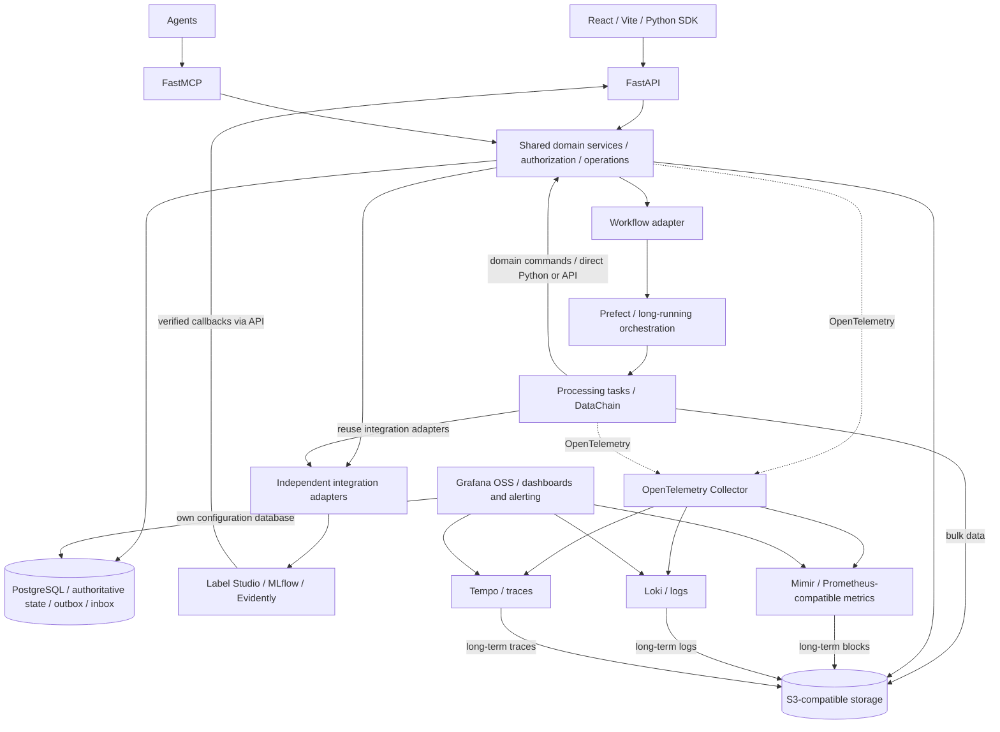

# Dataset platform architecture

**Decision:** Verdant adopts architecture baseline v1.0 for internal organizational deployment: a dataset-first modular Python monolith, shared FastAPI/FastMCP application services, PostgreSQL operational state, and S3-compatible artifacts, with independently scalable workers.

**Status:** accepted target; no runtime implementation claim. [Source](REFERENCE-BASELINE.md) preserves the supplied reference through its truncated section 7. Sections on delivery, publication concurrency, security, and recovery below are derived design guidance needed to satisfy the source's principles, not recovered missing source text. See [ADRs](adrs/README.md) and [acceptance requirements](../REQUIREMENTS.md).

## Principles and placement

Datasets exist independently of experiments, annotations, or models. Published versions never change in place. Pydantic v2 governs contracts; domain services enforce business rules and permissions; PostgreSQL constraints enforce integrity. Workers process bulk data against object storage, while APIs manage bounded metadata and operations. Start as one Python project; split network services only for demonstrated scaling or deployment needs.



### Execution follows domain authority, not a mandatory network hop

Shared domain services admit work and own registry changes, quality gates, publication and logical operation state. Trusted Python workers may import and call those services directly with an explicit principal and unit of work. This is the default inside the managed deployment when it reduces latency and operational dependencies. Remote, differently trusted or non-Python workers use authenticated FastAPI commands. Both paths execute the same authorization and invariants; direct Python calls are not raw table writes.

First-party workers can use platform database access through the existing application/persistence modules with credentials appropriate to their role. Third-party tools receive only the integration/API/object access they need. No separate worker credential framework or per-module database role is required without a demonstrated isolation need. Deploying in one trust boundary does not remove namespace checks or allow arbitrary SQL to bypass version integrity.

Prefect coordinates durable, long-running execution. Domain-owned Label Studio, MLflow and Evidently adapters are peers: interactive reads, annotation callbacks and lightweight experiment associations do not require a Prefect flow. Flows reuse these adapters for long-running work. DataChain reads/writes bulk artifacts directly; all registry/result/publication mutations return through domain services, in process or over API. Provider callbacks are validated and deduplicated at their boundary.

### Practical operating priorities

Optimize for reproducible results, bounded resource use, predictable performance and recoverable failures. Authorize each command or bounded work batch once at its application boundary; pass the validated principal/context through nested calls rather than repeating network identity checks per sample. Recheck current access when accepting a result or publishing. Use the existing OIDC library and ordinary service identities; short-lived object URLs and scoped storage roles are alternative deployment tools, not mandatory custom capabilities.

Use bounded retries with backoff for transient failures, durable checkpoints for resume and automatic reconciliation wherever a provider supports safe lookup. Escalate only ambiguous non-idempotent effects; unrelated reads/work continue. Telemetry, search projections, optional integrations and SSE outages must not block authoritative registry reads or already-admitted work that does not need them. Expose degraded status and recover asynchronously. Missing required content, invalid identity, failed publication gates and uncertain irreversible effects still prohibit a false success.

Self-hosted Keycloak supplies organizational identity for humans and first-party service clients in Compose and Kubernetes. This is an internal organizational deployment, not a public SaaS identity/tenancy design. The frontend uses backend-owned Keycloak OIDC sessions; enabled dashboards use the native SSO/plugin/proxy paths in the [cluster integration matrix](../infra/local-auth.md). Standard database/storage/integration machine credentials remain appropriate to their protocols. FastMCP and FastAPI are transport adapters, not independent policy engines. External callbacks authenticate and normalize provider data before invoking shared services.

| Layer | Technology / responsibility |
|---|---|
| Browser | React/Vite; TanStack Query caches API state; TanStack Table presents paginated data; React Flow renders lineage |
| API | FastAPI REST/OpenAPI; SSE progress; authenticated integration webhooks |
| Agent adapter | FastMCP tools/resources with scoped authorization |
| Contracts | Pydantic v2 domain, integration, storage, request/response, event models |
| Persistence | PostgreSQL, SQLAlchemy 2, Alembic; transactional outbox/inbox |
| Execution | Prefect orchestration/retries; DataChain ingestion and transformations |
| Annotation | Label Studio editing/review with canonical revision import |
| Experiments | MLflow runs/metrics/model registry associated with dataset versions |
| Quality | Evidently reports and drift; domain services own publication policy |
| Storage | S3-compatible source objects, data, manifests, report artifacts |
| Signals | OpenTelemetry traces/metrics/logs exported through the OpenTelemetry Collector to Mimir (Prometheus-compatible metrics), Loki (logs) and Tempo (traces), queried through Grafana OSS |
| Clients | Generated OpenAPI clients plus typed Python SDK helpers |
| Deployment | Static frontend; containerized control plane, workers, and integration services |

## Module ownership

| Module | Owns |
|---|---|
| Identity & Access | Keycloak principal mapping, users/agents/service principals, organizational roles and dataset/project namespace permissions |
| Dataset Registry | Dataset identity, ownership, metadata, discovery |
| Schema Registry | Versioned Pydantic/JSON Schema contracts and compatibility |
| Sample Registry | Stable sample identity, content revisions, metadata |
| Annotation Management | Annotation revisions, review provenance, Label Studio mapping |
| Dataset Versioning | Drafts, membership, splits, manifests, immutable publication |
| Lineage | Typed source/target relationships and transformation provenance |
| Quality | Policies, evaluations/reports, gate decisions |
| Operations | Async lifecycle, idempotency, cancellation, retries |
| Workflow Integration | Prefect invocation and external run correlation |
| Experiment Integration | MLflow run/model associations |
| Events | Durable events, outbox delivery, inbox deduplication, subscriptions |
| Audit | Actor, action, access/change history and outcomes |

Modules own persistence models and migrations. Cross-module foreign keys are allowed for essential integrity; writes cross module boundaries through application services. Do not expose SQLAlchemy models as transport contracts or let integration databases become authoritative platform state.

## Target repository layout

This is a logical implementation destination, not a claim that the directories already implement these roles. Packages can initially live in one Python project.

```text
apps/
  api/                  FastAPI adapter
  mcp/                  FastMCP adapter
  web/                  React + Vite
  workers/              Event and integration execution
  workflows/            Prefect flows
  docs/                 Starlight documentation only
packages/
  contracts/            Pydantic models
  domain/               Entities and invariant rules
  application/          Shared use cases and services
  persistence/          SQLAlchemy repositories
  integrations/
    datachain/
    label_studio/
    mlflow/
    evidently/
  events/               Event contracts and dispatch
  storage/              S3-compatible artifact access
  observability/        OpenTelemetry setup
  sdk/                  Generated client and typed helpers
frontend/generated-api/ OpenAPI TypeScript client
migrations/             Alembic migrations
infrastructure/
  compose/
  terraform/
  deployment/
tests/
  unit/
  integration/
  contracts/
  end_to_end/
  performance/
```

Infrastructure directories are suggested placement from the reference, not authorization to provision services or a requirement to add unused scaffolding.

## Canonical entities

Every entity and operation carries namespace/tenant context where applicable. The exact isolation model is an implementation decision; scoped authorization is mandatory from the first slice.

| Entity | Identity and contents |
|---|---|
| Dataset | Stable ID, slug/name, owner, modality, metadata, access policy |
| DatasetDraft | ID, dataset ID, base version, mutable revision, lifecycle status |
| DatasetVersion | ID, dataset ID, version label, generation ID, schema version, manifest digest, publication evidence, published time |
| Sample | Stable ID, source identity, modality |
| SampleRevision | ID, sample ID, exact content digest/reference, metadata |
| Annotation | ID, sample revision ID, task type, label schema |
| AnnotationRevision | ID, annotation ID, revision, payload digest, reviewer/provenance |
| PublicationCandidate | ID, draft ID and expected revision, generation ID, preparation/validation state, gate evidence, retention protection |
| MembershipGeneration | ID, dataset ID, source draft revision, building/sealed state, count and deterministic membership identity |
| DatasetMembership | Generation ID, sample revision ID, annotation/review/schema references, split; versions resolve membership through their generation |
| ReviewEvidence | Immutable annotation revision, decision, reviewer, timestamp, applicable policy/schema revision |
| ArtifactRecord | ID, digest, size, resolvable locations, available/deleting state, durable retained references and temporary preparation protection |
| Transformation | ID, code version, configuration digest, environment |
| LineageEdge | Source artifact, target artifact, relationship, operation ID |
| QualityPolicy | ID, version, rules, severities, thresholds |
| QualityReport | ID, candidate/version identity, policy version, result, artifact reference |
| EffectReceipt | Stable logical effect key, request digest, provider reference/result, pending/unknown/completed state; shared across execution attempts |
| Operation | ID, type, actor, state, idempotency key, attempt epoch, external run references |
| DomainEvent | ID, aggregate ID, type, schema version, payload, occurred time |

A logical sample ID survives metadata corrections. Content digest identifies bytes of a sample revision. A transcription correction creates an annotation revision; an image replacement creates a sample revision. A sample may occur in many datasets/versions with distinct splits and annotations. Draft membership has its own revisioned working state; published membership pins exact immutable references.

Lineage connects input and output versions/revisions, transformation code/configuration/environment, annotations, reports, and MLflow associations. A published snapshot must remain resolvable even when external integration metadata changes.

### Snapshot semantics

| Mutable catalog state | Immutable version content |
|---|---|
| Dataset display name, discovery description, owner and current access policy | Frozen dataset descriptive metadata used for interpretation |
| Current draft pointer and latest-revision suggestions | Sample bytes **and sample metadata revision**, annotation payload and task/label-schema revision |
| Current access/revocation policy and external run status | Review-decision evidence, transformation definition/code/configuration/environment, membership and split assignments |
| Later reports and experiment associations | Exact quality-policy revision and publication-gate report/evidence references |

A sample metadata correction creates a new SampleRevision even when its content digest is unchanged. Annotation payload, label semantics and review evidence are immutable revisions; a later review adds evidence and cannot edit the record used by an old publication. Transformation, schema and policy revisions referenced by a version cannot be updated in place. Re-evaluations attach new reports without replacing the publication's gate evidence. Catalog edits may change discovery presentation but never historical interpretation or manifest bytes. Access policy remains current: publishing a snapshot does not freeze an entitlement to read it.

Publication pins a sealed membership generation: bounded membership rows point to exact revision IDs. Once sealed, persistence guards backed by database constraints/permissions or triggers prevent row mutation; later draft edits build another generation. A version points to this generation, rather than copying all membership during finalization. The initial manifest is versioned UTF-8 JSON with deterministic ordering and streaming encoding/reading. Use one manifest when it meets measured workload budgets; introduce digest-addressed shards and an index only when dataset size justifies them. Either representation pins membership and interpretation contracts, with explicit schema compatibility. Canonical encoding and deterministic ordering are fixed by schema-versioned test vectors before any version is issued; the manifest/index SHA-256 identifies exact bytes. Storage locations are resolvable references and may relocate only with digest verification, without rewriting the published manifest.

Candidate and generation are internal versioning concepts, not separate network services or mandatory CRUD APIs. Draft membership remains editable; publication captures a stable draft revision, materializes it in bounded batches, seals its generation, and a version references that generation. Capture uses a consistent snapshot or revision-addressable membership; retain the source revision until preparation finishes. Choose the simplest implementation with bounded transactions and acceptable snapshot lifetime. Edits after capture cannot change the captured membership or force a restart. Never copy a changing live query across unrelated snapshots. An abandoned candidate can resume or be discarded after its protection expires; published references remain retained. Review evidence can be embedded in the immutable annotation contract rather than requiring another table. Artifact references/protection can likewise use existing storage metadata tables. Choose physical tables from actual query and integrity needs; these logical relationships are mandatory, their table count is not.

## Contracts and compatibility

Three contract families are canonical: domain contracts, provider integration contracts, and storage contracts (manifests, Parquet records, object references). Use explicit schema versions and compatibility rules. Published manifests pin their schema version; retain readers or explicit adapters for older supported versions.

Pydantic v2 uses `extra="forbid"` and strict canonical in-process validation. External JSON parsing normalizes intentionally before canonical validation; strict Python objects and strict JSON do not accept identical input representations. Artifact references include URI, SHA-256 digest, and nonnegative byte size. Add namespace, actor/access classification, and compatibility metadata to production boundary contracts.

| Boundary | Enforcement |
|---|---|
| HTTP / MCP | Request/tool contracts, authenticated identity, bounded input |
| Application service | Authorization, lifecycle, idempotency, business invariants |
| Database | Foreign keys, unique/check constraints, transactions |
| Event producer/consumer | Versioned event validation and explicit unsupported-version handling |
| Label Studio adapter | Provider validation, canonical annotation normalization/revision checks |
| DataChain output | Record schema and bulk validation; bounded batches |
| Publication | Referential, manifest/digest, statistical and policy checks |
| SDK | Typed responses; version/manifest verification helpers |

Additive optional fields may be compatible. Renamed fields, changed types, or annotation semantics may require a major schema version. Pydantic does not replace relational constraints, content verification, or large-scale validation.

## PostgreSQL and artifact state

Logical schemas: `identity`, `registry`, `samples`, `annotations`, `lineage`, `quality`, `operations`, `events`, and `audit`. Schema registry/versioning tables belong to their owning modules. These namespaces share one database initially.

Use UUIDs (time-sortable where useful), typed columns for core fields, schema-validated JSONB for flexible metadata, and indexed filters/PostgreSQL full-text search initially. SQLAlchemy 2 owns persistence access and Alembic owns schema changes. CockroachDB is a possible later choice for demonstrated multi-region writes, not a constraint on initial design.

Derived concurrency design: draft writes compare an expected revision; reject stale updates. Database uniqueness scopes version labels and idempotency keys to the appropriate namespace/aggregate/operation. Publication finalization serializes competing transitions using a transaction and revision checks. Exact lock/isolation choices must be proved by integration tests before release.

S3-compatible storage holds source bytes, processed records, manifests and reports. Local Compose uses one SeaweedFS OSS single-node S3 service with persistent data/metadata; cloud backends are selected through qualified endpoint/region/credentials/bucket/addressing configuration. Standard S3 clients, stable logical artifact references and separate placement mappings avoid coupling domain identity or published manifests to local hostnames. See [Local S3 storage and portability](../infra/local-object-storage.md). References identify storage location and digest without making a bucket vendor the dataset identity. Verify object completion and digest before committing a usable reference. Never infer tenant authorization from possession of an object URI.

## Lifecycle and publication

### Lifecycle and availability

| Resource / transition | Effect |
|---|---|
| Draft/candidate validation | Validation belongs to a frozen candidate. Later draft edits do not invalidate it; they only mean it no longer represents the latest draft |
| Draft: validation failure | Return actionable errors and permit correction/retry; preserve evidence and checkpoints |
| Publish | Create a new immutable version from a validated candidate; preserve the working draft so users can continue editing |
| Version: active → deprecated → active | Warn and omit from default recommendations while preserving exact-version reads and membership |
| Version: active/deprecated → archived | Hide from normal discovery; exact-version reads remain available to authorized clients; preserve previous state for unarchive |
| Dataset: active → archived → active | Hide from default discovery and pause new mutation/work admission; allow inspection and authorized reads of retained versions; unarchive restores admission |
| Existing work during dataset archive | Preserve checkpoints; allow safe completion of admitted work, but pause publication/new work until unarchive or explicit owner cancellation |

Archive/deprecation are mutable catalog availability flags, not rewrites of version contents. Explicit filters expose them where authorized; return warning/status information rather than breaking pinned consumers. Unarchive restores visibility/state without republishing or changing digests. Permission revocation independently denies access. Destructive deletion, legal holds and retention expiry use a separate explicit policy and audited operation; archiving never implies byte deletion.

### Publish a candidate while editing continues

1. Capture a consistent draft revision and create a candidate. The default publication request selects that candidate explicitly. Bind `(namespace, command type, idempotency key)` to candidate identity and request digest; an identical retry returns the same operation/result, and conflicting reuse is rejected.
2. Prepare/seal its membership generation in resumable batches against the captured revision. Editors may advance the working draft independently. UI/SDK report both “publishing revision 42” and “current draft revision 45” when they differ.
3. Validate exact generation contents, pinned policies and interpretation contracts; write/verify the manifest. Preparation establishes durable artifact protection and verification evidence for that generation before marking it ready. Membership scans, object checks and reference enumeration occur here, outside finalization.
4. In a short transaction, lock the candidate/retention-group guard and operation guard, recheck current authorization, dataset availability, sealed generation, ready verification evidence, and passing gates. Atomically promote its protected retention group from prepared to published, insert the unique dataset/version label pointing to generation/manifest digest, and record audit/event/outbox plus terminal operation result. No per-member/per-object scan, reference rewrite, upload or remote call occurs in this transaction.
5. Return the committed result on retries. The latest draft revision need not equal the captured revision. An explicit “publish current draft” request additionally compares the expected current revision at finalization and reports a conflict if it changed; it does not silently select another candidate or discard reusable preparation.

### Aggregate retention and collection safety

During bounded preparation, register each required artifact reference under a candidate retention group before relying on it. Creating a reference serializes with the artifact's deletion claim and refuses deleting/missing artifacts. Sealing preparation verifies complete reference enumeration and stores a readiness record bound to the immutable generation, manifest and gate evidence. Readiness is not a user assertion: only the completed preparation protocol can set it. Direct application writes cannot edit a sealed reference set.

Prepared and published groups both protect their complete artifact sets. Finalization promotes one group record; it neither recreates nor rechecks every reference. Candidate expiry/release and publication serialize on that same group guard. Expiry marks the group releasing and invalidates readiness before batched cleanup; finalization refuses releasing/expired groups. Resumption after expiry reestablishes protection and readiness before publishing. Published groups never expire implicitly.

The collector claims an artifact deleting only when no active preparation or published group protects it; reference creation and deletion claims serialize on its artifact guard. Deletion happens externally after the durable claim, with recoverable outcome tracking. Cleanup may lag conservatively and retain extra bytes; it must never free bytes still protected. Grace periods are optional operational cushions, not the integrity mechanism. PostgreSQL/object storage have no shared transaction: uncommitted uploads remain staged and recoverable, never published success. Unexpected out-of-band deletion/corruption is detected on reads and handled by repair/restore; retention guards do not promise protection against storage failure.

## Durable delivery and operations

Derived event protocol: state change, audit/event, and outbox entry commit atomically in PostgreSQL. Dispatchers lease/claim work, deliver at least once, retry transient failures with backoff, and retain actionable failures. Consumers validate versioned envelopes and use inbox uniqueness plus the local mutation in one transaction. Do not promise global ordering or exactly-once transport.

### Projections and subscriptions

Each consuming domain owns its read projection (for example registry search or lineage summaries), schema and rebuild procedure; Events owns delivery and consumer checkpoints. Start with indexed authoritative SQL queries whenever sufficient. Add asynchronous projections only for measured query needs. Apply event effects and a consumer checkpoint/inbox entry atomically; track aggregate revision to detect stale/out-of-order updates and reload authoritative state where necessary. Unsupported events remain visible as consumer failures, not silent skips.

Rebuild from authoritative PostgreSQL state or retained version manifests at a recorded watermark, then catch up retained events; use a new projection generation and switch readers only after catch-up. Retain needed events for the rebuild window or restart from a fresh snapshot. Rebuilds are resumable and leave existing reads available. Search responses expose projection freshness; publication, permissions, exact-version reads and destructive decisions use authoritative state, never an eventually consistent projection. Filter projected results through current access policy, including counts and lineage.

“Subscriptions” has three distinct meanings: internal durable consumers use outbox/inbox and checkpoints; client SSE provides reconnectable progress notifications with authoritative status fallback; outbound webhooks are opt-in integration adapters added only when needed. An expired SSE cursor tells the client to refresh current state, without losing the operation. Outbound webhook delivery, if enabled, has per-subscriber delivery IDs, authenticated endpoints, bounded retry/backoff and replayable failures; slow subscribers never block domain commits. SSE is not a durable processing queue.

### Execution authority and retry ownership

| Concern | Sole authority / rule |
|---|---|
| Logical operation status | Operations domain service in PostgreSQL; Prefect state is an observation |
| External run admission | Workflow Integration adapter; one persisted dispatch record per operation attempt |
| Dispatch timeout | Dispatcher reconciles by stable invocation key; it does not create a new logical attempt |
| Task retry within one flow | Prefect, within a bounded configured policy; task effect keys remain stable across retries |
| New workflow attempt after terminal failure | Explicit Operations retry command increments attempt epoch and records provenance |
| Result acceptance/publication | Domain services validate identity, current authorization, expected revisions and attempt fencing |
| Cancellation | Operations records cancellation requested, adapter forwards it; only Operations decides the terminal outcome |

A dispatch key is derived from namespace, operation ID and attempt epoch; the adapter must use a supported provider idempotency mechanism or reconcile the external run by that key. A crash after accepted dispatch is an uncertain outcome, not a failed invocation. If the provider cannot establish whether work was accepted, mark reconciliation required and stop automatic resubmission. Do not assume a finite provider deduplication window grants permanent exactly-once behavior.

Task side effects use a stable logical key such as `(namespace, operation, effect type, logical item, input/configuration revision)`, **excluding attempt epoch and retry count**. Include enough item identity to distinguish separate intended effects. Use a unique receipt key and short transactional claim so concurrent workers cannot independently dispatch the same effect. Persist the request digest and an EffectReceipt before dispatch; completed receipts and provider references survive failed workflows and new epochs. Identical retries reuse the receipt/result, while conflicting payloads under the same key are rejected. Intentional repetition or changed inputs create a new logical effect, not a new attempt disguised as new work.

Epochs fence execution ownership and result acceptance; they do not change effect identity. An unknown effect must reconcile before reissue, even after a new workflow attempt. Provider lookup may resolve an effect after the originating worker became stale; an authorized reconciler records that fact without allowing stale workers to finalize the operation. Keep receipts throughout the supported retry/recovery window; do not discard them merely because a flow finished or provider deduplication expired. When deduplication/receipts are no longer sufficient, require reconciliation or an explicit new action rather than silently replaying a write.

PostgreSQL inbox uniqueness and the resulting mutation commit together. Artifact retries write deterministic immutable keys and verify existing digests. For an external provider lacking idempotency/lookup, an ambiguous write stops for reconciliation rather than risking repeated billing or duplicate annotation tasks. Each adapter must document its actual capability before activation.

Operations distinguishes queued, running, cancellation requested, cancelled, succeeded and failed; uncertain dispatch is exposed as a reconciliation-required condition. Success requires accepted committed domain results, not merely a successful Prefect flow. A successful flow lacking registered results remains nonterminal pending reconciliation. A failed flow cannot reverse already committed success. Cancellation and finalization serialize on the operation guard: whichever commits first determines the permitted transition. Stale epoch results are rejected; already committed effects remain auditable.

Workers carry a verified user/service principal and explicit operation/namespace context; a job ID is not authorization. Authorize bounded claims/batches, credential renewal and result/finalization commands, not each record or internal helper. Use local validated token material and shared policy evaluation without a synchronous identity-provider call per command; normal expiry/revocation rules still apply. Revoked access stops new claims/result acceptance. Direct storage credentials or temporary URLs follow the deployment's documented revocation/expiry behavior; neither can retract bytes already downloaded.

SSE is a progress projection; PostgreSQL operation state is the recovery source. Quarantine unsupported events and expose audited replay. Provider callbacks never bypass the domain transition rules.

### Enforced dependency and transaction boundary

Domain rules import no transport, ORM or provider modules. Application use cases depend on domain/contracts and the repository/integration capabilities they actually use. Persistence and provider adapters implement those dependencies; API/MCP composition roots wire them. Do not create interfaces without a boundary need. Add import-boundary checks for prohibited dependencies and contract tests for all privileged worker entry points.

The initiating application use case owns one SQLAlchemy unit of work across participating modules. Module services share that transaction; they do not commit independently or perform external calls while holding it. A restricted event dispatcher may claim outbox rows through the Events service, but cannot mutate registry tables. Managed Python workers can use this same application/persistence path directly; remote API workers use a transport adapter. Both retain the same principal, transaction and integrity rules. This preserves one domain authority without forcing bulk data through it.

## End-to-end flows

### Ingest and transform

Authenticate → authorize dataset/draft → register verified source reference → commit operation/outbox → dispatch Prefect → DataChain reads source objects in bounded batches → store outputs/digests → application service registers sample revisions, draft membership and lineage → commit completion/events. Failure leaves an auditable operation and recoverable staged outputs, not partial publication.

### Annotate and review

Export exact sample revisions and label schema to a mapped Label Studio project. Verify callback identity/signature and replay constraints, deduplicate external events, normalize results, and create annotation revisions with review provenance. Changed/stale callbacks cannot silently overwrite accepted revisions. Draft owners choose revisions; published membership remains unchanged.

### Evaluate and consume

Run Evidently against a pinned candidate/version and policy; store report bytes in object storage and metadata in PostgreSQL. Quality services enforce gates. MLflow records runs, metrics, and model associations referencing exact dataset versions. SDK/REST/MCP consumption resolves an authorized immutable manifest, verifies digests, and reports missing/corrupt bytes explicitly. Re-evaluation creates a new report, not a mutated snapshot.

### Discover and observe

Registry queries apply namespace/access filters before returning rows, counts, lineage edges, or pagination data. API/worker telemetry carries operation/event/external-run correlation through the OpenTelemetry Collector: traces go to Tempo, metrics to Mimir and logs to Loki, all queried through Grafana OSS. Domain audit remains durable in PostgreSQL independently of telemetry retention.

## Security, deployment, and recovery

Use Keycloak OIDC/OAuth 2.0 identity verification (issuer, audience, signature, expiry) and scoped human/service/agent credentials. Apply resource authorization in shared services for every transport and background action. Integration credentials are backend-only and least privilege. Validate callbacks; constrain outbound ingestion URLs against SSRF; treat documents and labels as untrusted data, including when an LLM processes them. Never log tokens, raw private samples, or signed URLs.

Docker Compose and Kubernetes are first-class self-hosted organizational targets with Keycloak frontend/cluster SSO and the same authenticated dataset lifecycle and recovery proof; see [Compose acceptance](../infra/docker-compose.md). Deploy static frontend and containerized control-plane/worker components. FastAPI and FastMCP may share a process or image initially; authorization and domain logic remain shared. Scale processing independently. Set workload-based limits, queue backpressure and timeouts; do not route bulk dataset payloads through the API. Provider, topology, regions, budgets, backup targets and numeric SLOs are open deployment choices.

### Shared resources without mandatory service separation

Within one deployment, give interactive API work and bulk workers separate connection-pool budgets and bounded execution concurrency; keep their total within PostgreSQL capacity with operating headroom. Use resumable batches, bounded in-flight object buffers and short transactions. Do not hold a database connection while waiting on a provider, object transfer or retry backoff. Queue work instead of increasing concurrent retries without bound; use jitter and bounded admission when providers recover.

Preserve interactive capacity during ingestion, projection rebuilds and retry storms. Set pool sizes, timeouts and batch sizes from observed workloads rather than fixed architectural numbers. A failed worker should lose only its bounded batch and resume from a checkpoint; exhausting a worker budget should delay background work, not require another network service or deny unrelated reads. Test responsiveness and recovery under shared-resource saturation before deployment capacity claims.

Back up PostgreSQL and object storage under a coordinated recovery policy. Prove restoration by resolving retained manifests and digests. Retain immutable referenced objects; deprecation changes availability policy, not bytes. Expand/contract migrations and compatible event/manifest readers preserve rollback. See [Publishing](PUBLISHING.md), [Testing](TESTING.md), and [Implementation](IMPLEMENTATION.md).

### Shared storage without duplicate service ownership

Grafana configuration uses its own database/user on the existing PostgreSQL service. Mimir is the single Prometheus-compatible metric store with S3-backed blocks; Loki/Tempo use distinct buckets in the same object service. The Collector ingests/exports each source once, without a parallel Prometheus server or duplicate alert pipeline. Bounded recovery buffers/cache are permitted and qualified separately from long-term storage. See [Storage ownership](../infra/storage-ownership.md) for integration metadata and domain authority boundaries.
