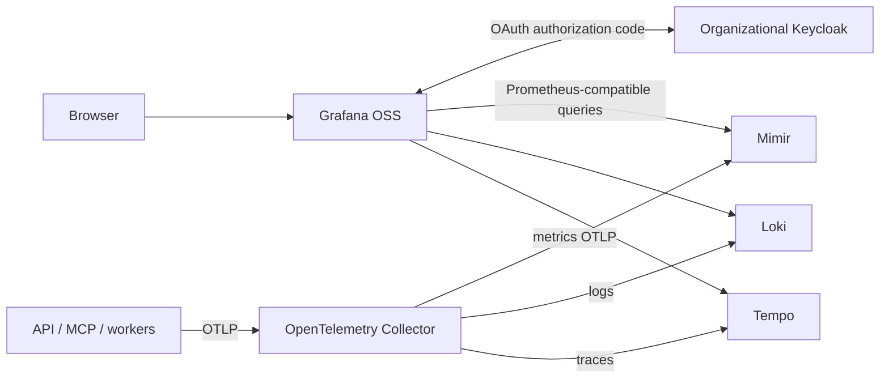

# Grafana OSS–Keycloak integration

## Decision and readiness

Use Grafana OSS with built-in Keycloak/Generic OAuth, Mimir for Prometheus-compatible metrics, Loki for logs, Tempo for traces and the OpenTelemetry Collector for collection/export. Grafana owns dashboards and alerting. Applications remain instrumented with OpenTelemetry. Use OSS distributions: Grafana/Mimir/Loki/Tempo are AGPLv3; the Collector is Apache-2.0. No paid SSO dependency, custom authentication fork or broker is required.

This is the accepted target, not an installed stack. Pin compatible images and configuration before runtime qualification. Use Grafana's built-in OAuth integration and the [cluster identity contract](local-auth.md).

## Ownership and flow

Keycloak owns identity, MFA and organizational admission. Grafana owns individual accounts, sessions and organization roles. Verdant owns dataset permissions and durable PostgreSQL audit. Dashboard membership does not grant dataset authorization. Use separate origins and host-scoped cookies; never forward Verdant tokens/cookies or put credentials in links.

## Configuration contract

Create a dedicated confidential Grafana client per environment in the existing realm. Enable authorization code flow, disable unused grants, and register exactly `https://<grafana-host>/login/generic_oauth`, including any configured external subpath. Configure Grafana's canonical root URL first. Browsers and Grafana containers/pods must reach the same trusted HTTPS realm endpoints.

Use built-in `[auth.generic_oauth]` settings:

| Setting | Target |
|---|---|
| `enabled` | `true` |
| `client_id`, `client_secret` | Dedicated client; backend secret storage |
| `auth_url`, `token_url`, `api_url` | Realm discovery's authorization, token and userinfo endpoints |
| `scopes` | `openid profile email` and only necessary group claims |
| `use_pkce`, `use_refresh_token` | `true`; qualify required refresh scopes/configuration |
| `groups_attribute_path`, `allowed_groups` | Explicit group claim and approved membership allowlist |
| `role_attribute_path` | Approved groups map to Viewer, Editor or organization Admin; unknown groups yield no role |
| `role_attribute_strict` | `true`; reject unmapped roles |
| `skip_org_role_sync` | `false`; SSO owns managed organization roles |
| `allow_assign_grafana_admin` | `false`; organization Admin is not server administrator |

Proposed groups are `grafana-viewers`, `grafana-editors` and `grafana-admins`. Define/test multi-group precedence. Never use an unconditional Viewer fallback. Enable JIT only with group admission and strict mapping. Disable anonymous access and ordinary public password/signup bypass, including backend endpoints rather than only login buttons. Disable basic authentication where unused, preserving independently authenticated machine API routes.

Use native OAuth transaction/session handling. Qualify state/replay protection, PKCE, token/issuer validation and return-destination controls in the pinned version. Trust forwarded headers only from intended ingress; never disable certificate verification to solve DNS routing. Secrets, identities and session state persist across bootstrap/restart.

## Individual accounts and permissions

Use native external identity linking and prove stable subject identity across email/name changes. Disable insecure email-only OAuth account lookup. Existing accounts need operator-verified linking/migration; quarantine duplicate/recycled email conflicts and never silently merge administrators. No new identity-mapping service is required.

Initially this is an operator workspace with intentionally shared telemetry visibility. Grafana OSS folder/dashboard permissions do not restrict querying underlying data sources. Do not depend on Enterprise data-source permissions, custom RBAC, Team Sync or label-based access control. Stronger separation requires isolated organizations with correctly separated backends/data sources or separate stacks, with explicit query-isolation proof. Hidden dashboards are not data isolation.

Keep one writer for managed roles. Synchronization at login is not immediate deprovisioning: choose the maximum permitted removal interval, configure session/refresh lifetimes accordingly and prove supported local user/session revocation meets it.

## Machine access, telemetry and persistence

Keep Mimir, Loki and Tempo endpoints private. Grafana OAuth does not secure their query, ingestion or administrative APIs. Use existing gateway/TLS controls and supported machine credentials for exposed routes; Loki and Tempo require an external authentication boundary. A tenant header is routing context, not authentication: trusted gateways set/validate it and reject spoofed values. Prevent alternate direct ingress.

Use one Collector pipeline per signal with bounded memory, batches, retries and queues. Send metrics from the Collector directly to Mimir using its supported OTLP interface. Scrape infrastructure Prometheus-format endpoints with the Collector Prometheus receiver where needed; do not also scrape/export the same series through another path. There is no standalone Prometheus server or second metrics TSDB in the default profile. Export logs to Loki OTLP and traces to Tempo OTLP using compatible pinned versions. Select host/container collection sources intentionally to prevent duplicate ingestion. Preserve service/environment/operation and trace/span correlation; keep high-cardinality actors out of metric labels. Configure and verify Grafana trace-to-log and trace-to-metric links.

Machine clients use separate scoped ingestion/query/API credentials, never browser sessions or the OAuth client secret. Unauthorized API requests return 401/403 rather than login HTML. Redact tokens, signed URLs and private sample/annotation payloads. Telemetry outages shed data with visible loss counters rather than block domain commits; PostgreSQL audit/outbox remain authoritative.

Use Mimir as the one durable metrics backend, with blocks in a private bucket in the existing S3-compatible service. Grafana queries Mimir through its Prometheus-compatible data source; it does not require a Prometheus server. Logs and traces use separate Loki/Tempo buckets in that same service. Separate bucket ownership/retention and credentials do not require separate object-storage servers. See [Storage and service ownership](storage-ownership.md).

Start with a small supported Mimir deployment. A pinned version's supported classic/monolithic mode avoids introducing Kafka just for this profile; upstream prefers ingest-storage architecture for new large deployments, so qualify the selected small mode and revisit it when workload/availability requires. Do not copy a distributed Helm chart's default Kafka/object-store subcharts into the stack without reviewing the resulting dependencies. Retain bounded persistent ingester WAL/recovery state where that mode requires it; S3 blocks do not make all accepted recent writes instantly durable or eliminate disk. Size/test restart recovery and report the recent-write recovery window. Loki/Tempo and Collector also need appropriately bounded queues/WAL/scratch, not independent long-term local signal archives.

Grafana uses its own `grafana` database and database user on the existing PostgreSQL service, with `[database] type = postgres` and secrets supplied by the deployment. This is Grafana's application database, not merely a PostgreSQL query data source. No embedded SQLite configuration database or separate PostgreSQL server is needed for Grafana. Provisioned dashboards/alerts remain code-managed; avoid manually maintaining a second copy of the same configuration. Document single-instance availability honestly; Kubernetes replicas alone do not establish backend availability.

Provision data sources, dashboards, alert rules and contact points repeatably. Grafana owns initial alert evaluation/notification; do not duplicate equivalent backend rules. Set retention/capacity/thresholds from workload and agreed SLOs. Add an external health/dead-man check because a failed alerting stack cannot reliably notify on itself. This design change sends no notifications.

## Logout, removal and recovery

Grafana and Verdant logout clear their own sessions. A Keycloak redirect is not proof of global session invalidation. Test refresh-token expiry/revocation and Grafana idle/absolute lifetimes. For removal: deny Keycloak admission, disable downstream user access, revoke Grafana sessions and separately revoke affected API credentials. Preserve historical user IDs and ownership; record the measured residual access interval.

Keycloak outage blocks new login/refresh; existing sessions remain bounded by qualified lifetimes. Keep a sealed audited server-admin recovery identity behind an operator-restricted recovery route; test public password endpoint restrictions independently of form visibility. Back up Grafana state/provisioning and backend data/metadata needed for recovery targets. Test signing-key/client-secret rotation. Roll back compatible images/configuration without overwriting newer identity/data state or reopening anonymous/password access.

## First implementation slice and acceptance

1. Pin OSS image digests and licenses. Provision private persistent backends, data sources, one OAuth client and one approved Viewer. Keep the profile optional until qualified.
2. Demonstrate Verdant → Grafana SSO with individual accounts and no second password. Test two users, every approved role, authenticated nonmembers, unmapped roles, changed/recycled email and existing-account linking. Deny fallback Viewer and server-admin escalation.
3. Emit one API/MCP → worker operation with traces, logs and metrics; query all signals and follow working correlation links. Verify durable audit separately. Prove one alert reaches a controlled test receiver without duplicate evaluation.
4. Test callback replay/state errors, incorrect issuer/audience, downgrade/removal, refresh failure, local/global logout, password/anonymous/direct-backend bypass and spoofed tenant/identity headers. Record actual session/removal bounds without assuming Enterprise features.
5. Disable each backend, Collector and Grafana independently; domain commits continue and memory/queues remain bounded. Test loss/recovery visibility, secret/key rotation, restart and restore with preserved identities/dashboards/data. Repeat canonical TLS/DNS, private routing and storage checks on Kubernetes.

Evidence comprises pinned configuration and redacted browser/API/telemetry/recovery results. This document and a docs build do not prove runtime readiness or supply deployment manifests.

## Sources

- [Grafana Keycloak integration](https://grafana.com/docs/grafana/latest/setup-grafana/configure-access/configure-authentication/keycloak/)
- [Generic OAuth admission and role mapping](https://grafana.com/docs/grafana/latest/setup-grafana/configure-access/configure-authentication/generic-oauth/)
- [OSS versus Enterprise permissions](https://grafana.com/docs/grafana/latest/administration/roles-and-permissions/)
- [Loki OTLP ingestion](https://grafana.com/docs/loki/latest/send-data/otel/)
- [Tempo authentication](https://grafana.com/docs/tempo/latest/operations/authentication/)
- [Grafana licensing](https://grafana.com/licensing/)
- [Prometheus local and remote storage limitations](https://prometheus.io/docs/prometheus/latest/storage/)
- [Mimir object storage](https://grafana.com/docs/mimir/latest/configure/configure-object-storage-backend/)
- [Collector metrics directly to Mimir](https://grafana.com/docs/mimir/latest/configure/configure-otel-collector/)
- [Mimir classic architecture and WAL](https://grafana.com/docs/mimir/latest/get-started/about-grafana-mimir-architecture/about-classic-architecture/)
- [Grafana application database configuration](https://grafana.com/docs/grafana/latest/setup-grafana/configure-grafana/)

Capabilities were checked for design on 2026-10-26; qualify the actual pinned versions before deployment.
